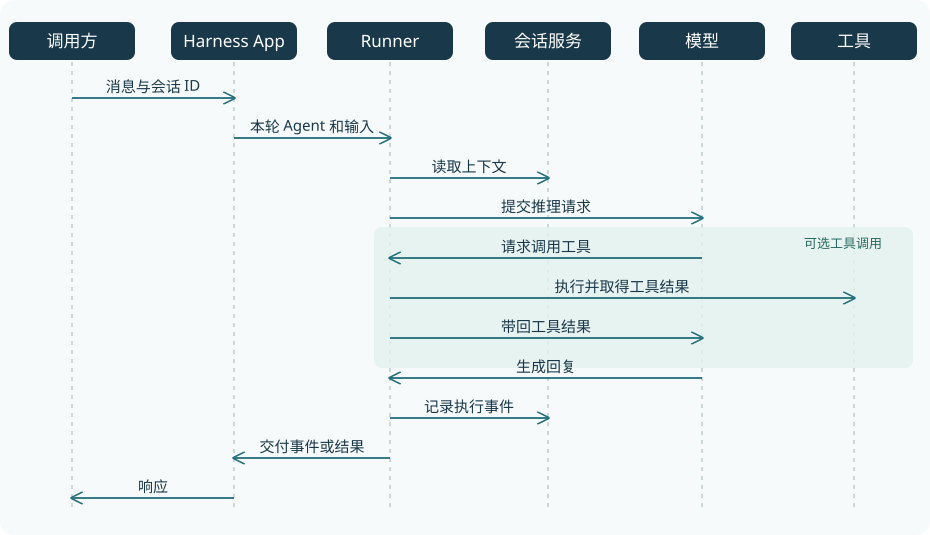

# 一轮对话的执行链路

以一个报告助手为例，用户问「这份报告列出了哪些风险？」。如果报告内容已经在上下文中，模型可以直接作答；如果需要查询知识库，Runner 会先执行模型选中的工具，把结果放回这一轮，再继续生成回答。两个过程使用同一个 HTTP 入口。

图中将事件交付和记录集中画在末尾；流式调用中两者可随执行过程发生。

| 阶段 | 本轮发生什么 | 调用方可以观察什么 |
|---|---|---|
| 接收 | 接口读取用户、会话标识和 ADK 消息，按当前身份模式及请求字段选择处理路径。 | 请求校验失败时先检查 HTTP 状态与响应体。 |
| 准备 Harness Agent | 兼容入口按需复制部署时的 Agent，将显式提供的覆盖字段应用到副本。使用部署默认配置的请求可以复用已有 Agent。 | 用相同的会话标识可以连续传入不同的本轮配置。 |
| 恢复上下文 | Runner 根据应用名、用户和会话找到对应的短期记忆，并将新消息交给 Harness Agent。 | 当前消息只需包含本轮输入，已写入会话的历史可以通过会话详情读取。 |
| 执行 | Runner 驱动模型和工具；同一轮可能包含多次模型调用。对流式入口，原生事件能够在模型完成前发给客户端。 | 文本增量、工具请求、工具结果和完整消息各有不同的展示方式。 |
| 返回与清理 | 同步调用整理本轮文本和产物；流式路径逐帧发送事件。请求级插件完成收尾，临时目录和请求资源随调用释放。 | 下一轮可以继续使用同一会话；需要持续使用的请求覆盖应再次提供。 |

## 同一个问题从两个入口发出

面向聊天界面时，用 `POST /run_sse` 发送 `new_message`；消息可包含多个 part。兼容入口 `POST /harness/invoke` 接收 `prompt`，等待整轮结束后给出一个 JSON 结果。后者只在镜像未启用且未强制共享身份的配置下提供。流式路径中，普通 ADK 请求和需要 Harness 请求级绑定的调用可能由不同处理器承接，接入时应根据实际启用的入口选择参数。

## 模型调用次数与轮次

用户的一条消息通常表示一轮，而工具调用可能让模型在一轮内执行多次。例如先选工具，读到工具返回的报告片段后再总结，就可能发生两次推理。设置 `max_llm_calls` 时，应为工具返回后的继续推理留出余量。这个限制作用于当前执行；跨轮的上下文由会话管理。
