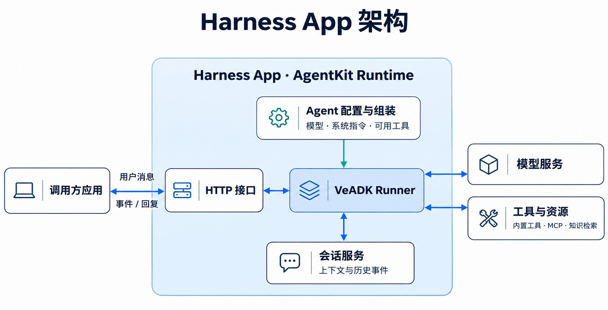

# Harness App 概览

Harness App 是运行在 AgentKit Runtime 中的 Agent 执行服务。应用通过 HTTP 发送用户消息和会话标识。Harness App 根据配置为本轮的 Harness Agent 准备模型、系统指令和工具，由 VeADK Runner 结合会话上下文执行对话。模型请求工具时，Runner 将工具结果带回本轮执行，再通过 HTTP 接口向应用返回事件或最终回复。



Harness App 适合应用主动发起一轮对话并直接消费结果。调用方持有用户和会话标识，可以围绕同一个会话连续提问。本例使用已授权的 AgentKit Runtime HTTP 入口；下文的路径相对于该入口，网关认证使用所在环境的配置。

## 创建会话

先请求 `GET /list-apps` 获取服务上的应用名。将返回的名称代入下面的路径，创建属于用户 `reader-1` 的会话，并从响应中保存 `id`。

```http
POST /apps/{app_name}/users/reader-1/sessions
Content-Type: application/json

{"id":"reading-1"}
```

## 在 Runtime 上完成第一轮对话

使用刚创建的会话，按[流式调用示例](features.md)向 `POST /run_sse` 发送第一条用户消息。读取消息事件并显示回复。下一轮复用相同的用户和会话标识。

## 通过兼容接口取得完整文本

以下示例适用于使用 Runtime 网关认证且未启用共享身份模式的 Harness App。此模式提供同步调用入口。

```http
POST /harness/invoke
Content-Type: application/json

{
  "prompt": "用一句话解释工作队列。",
  "harness_name": "reading-assistant",
  "run_agent_request": {"user_id":"reader-1","session_id":"reading-1"}
}
```

响应中的 `output` 是这轮的最终文本。先检查 `error` 再展示结果。下一轮沿用相同的用户和会话 ID，将 `prompt` 换成“给我一个例子”。要在生成过程中更新界面，见[流式响应与事件消费](features.md)。

## 按开发任务继续阅读

| 你要做什么 | 对应文档 |
|---|---|
| 理解模型、工具和会话各在何时参与执行 | [一轮对话的执行链路](flow.md) |
| 把 Runtime 接入应用，跨两轮保留上下文 | [两轮对话客户端](quickstart.md)、[会话与历史](sessions.md) |
| 给聊天界面展示中间过程和最终回答 | [流式事件](features.md)、[文件与产物](artifacts.md) |
| 给 Agent 配置外部能力 | [工具、MCP 与 Skills](tools.md)、[A2A 与定时任务](integrations.md) |
| 切换模型、工具服务环境或数据库 | [本轮调用参数](config.md)、[Runtime 高级配置](advanced.md) |
| 扩展请求字段或执行行为 | [开发指南](develop.md)、[接口参考](../api/app.md) |
