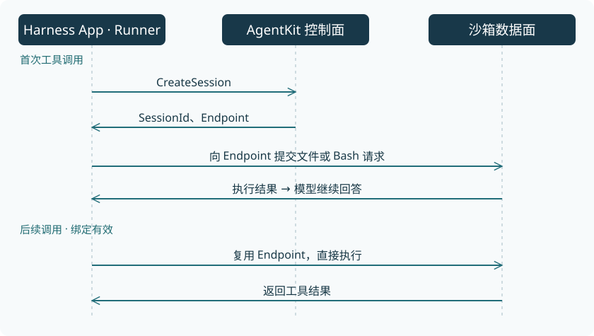

# 调用沙箱

Harness App 在 AgentKit Runtime 中维护对话、调用模型。为使用 ADK 后端的 Harness Agent 配置 AIO 沙箱 Tool 后，模型可以选用 `Execute`、`ReadFile`、`EditFile` 和 `WriteFile`。Runner 收到这类工具调用时，才会取得当前对话对应的沙箱地址，在远端执行命令或操作文件，再把工具结果交回模型。普通问答可以在模型已经看到这些工具的情况下直接完成。

## 从一次对话看文件在哪里

假设一个报告助手需要处理订单。应用始终向 Harness App 的 `POST /run_sse` 发送消息，保存同一组应用、用户和对话标识。

| 用户消息 | 模型选择 | 实际执行 |
|---|---|---|
| “解释一下 CSV 格式。” | 直接回答 | 这一轮只用模型推理，不触发沙箱创建。 |
| “把以下三笔订单写入工作目录的 orders.csv。” | 调用 WriteFile | 首次使用沙箱工具时，Harness App 根据选定的 Tool 获取沙箱 Session 和 Endpoint，再把文件写入沙箱工作目录。 |
| “读回刚才的文件，按城市汇总。” | 调用 ReadFile 或 Execute | 同一实例上绑定仍有效时直接复用 Endpoint，读取上一轮生成的文件。Runner 把读取内容或命令结果交给模型，再通过原来的对话连接返回回答。 |

这里有三个不同的标识：应用持有**对话 session_id**；Harness App 从应用、用户和对话标识派生稳定的 **UserSessionId**，用于关联创建请求；控制面返回的 **SessionId** 指向某一次实际分配的沙箱。用户能读回同一个文件，取决于后两轮是否落在同一个物理沙箱。

## 从工具声明到执行结果

1. **向模型提供工具。** Harness App 按部署配置及入口允许的请求参数准备 Harness Agent。启用 AIO 后，工具集给模型提供四个工具的名称和参数声明。若配置 Skill，准备模型请求时还可读取技能目录信息。
2. **从对话定位 Endpoint。** 模型发起沙箱工具调用后，执行器从工具上下文读取应用、用户和会话，在进程内串行处理同一绑定。首次调用向 AgentKit 控制面发送 `CreateSession`，参数包括 `ToolId`、`UserSessionId` 和 `Ttl`；取得可用 Endpoint 后缓存。
3. **把操作发到沙箱数据面。** 读取文本走 `/v1/file/read`，写入走 `/v1/file/write`。执行命令时，适配器先在工作目录创建 Bash 会话，再向 `/v1/bash/exec` 提交命令；需要等待时读取命令输出，最后取得标准输出、标准错误和退出码。文件路径相对于沙箱工作目录解析。调用方机器上的同名文件不会自动出现在该目录。
4. **继续模型执行。** 原生 ADK 工具将结果交回 Runner。模型可继续选工具，也可生成回答。前端沿原来的 Harness App 连接消费[流式事件](features.md)，无需自行构造沙箱 HTTP 请求。

### 何时会重新取沙箱

| 情形 | Harness App 的行为 |
|---|---|
| 当前绑定可用 | 直接向缓存的 Endpoint 发请求。 |
| 创建请求结果不确定 | 保留逻辑标识，后续可用 ListSessions 回查，避免因超时而重复创建。 |
| Endpoint 疑似失效 | 通过 GetSession 核实已有沙箱。文件读取返回 404 本身不足以证明整个沙箱已消失。 |
| 已知 TTL 到期 | 再次使用工具时创建新沙箱。同一对话可以继续，但此前沙箱内的临时文件可能已经不可用。 |
| Runtime 重启或请求切换到其他副本 | 进程内绑定无法直接复用。共享数据库可以恢复对话历史；需要跨轮继续操作同一工作目录时，还应考虑会话路由与沙箱 TTL。 |

## 配置 Skill 时，什么时候能读到文件？

**模型看到了技能说明、沙箱接受了加载请求、技能文件已经可读，是三个时刻。**

- **准备模型请求时**，工具集可用 `ListSkillsBySpaceId` 读取所选空间的技能名称和说明，供模型选择。这一步可以早于沙箱创建。
- **第一次使用该物理沙箱的工具时**，若请求选择了 Skill，Runtime 向其 Endpoint 的 `/v1/bash/exec` 发送固定命令 `/usr/local/bin/ve-load-skills`。技能引用和临时 STS 凭据通过本次 Bash 请求的环境传入。Runtime 检查响应成功、退出码为零且标准输出包含 `VE_SKILLS_LOAD_ACCEPTED` 后，将该物理 Session 标记为已受理。
- **后台加载器完成下载后**，技能文件才可读。加载脚本被受理后，当前工具调用可以继续，因此首次读取可能早于安装完成。同一物理沙箱已受理后会复用状态；换到新的物理 Session 才重新加载。对于结果不确定的受理请求，一个物理 Session 的尝试次数最多为两次。

### 读懂权限错误

创建沙箱时检查 Runtime 对 Session 控制面的授权；调用文件或 Bash 时检查 Endpoint 和沙箱数据面的认证；能看到技能说明但取不到文件时，还需检查加载器访问 Skill 服务及下载制品的身份。Skill 下载链路使用临时下载 URL，目标沙箱镜像应提供与下载协议相匹配的加载器。配置参数和分阶段的 IAM 权限见[高级配置](advanced.md)。
