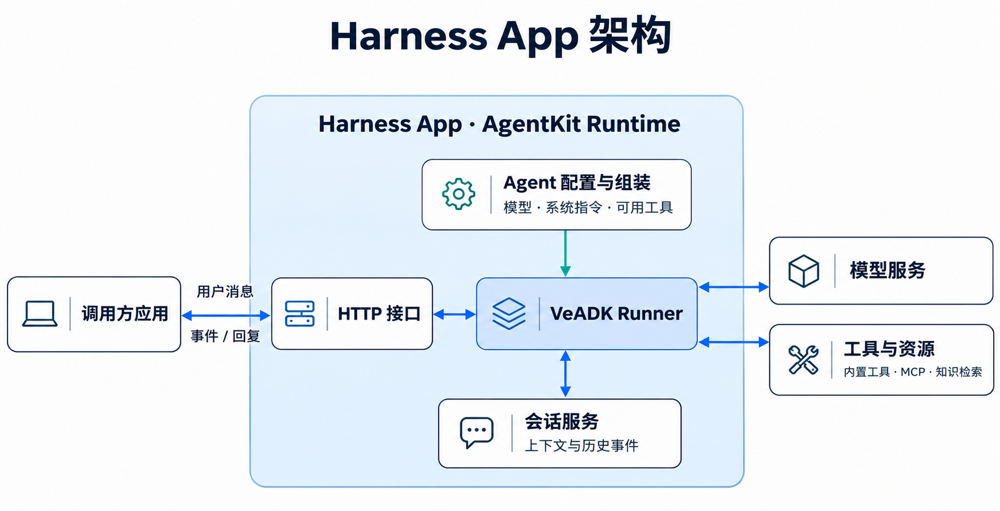

# Harness App 概览

Harness App 是运行在 AgentKit Runtime 中的 Agent HTTP 服务。业务应用通过它创建会话、发送消息和接收流式事件，服务端负责读取 Agent 配置、恢复对话历史，并执行模型与工具调用。

## 整体架构

图中展示请求进入 Runtime 后的执行关系。在 0.3.1 中，Agent 配置还可以从控制面的 Harness 与 Environment 读取，并绑定到 Session。控制面资源由应用预先创建，HTTP 服务在创建会话和显式刷新时读取它们。

| 组成 | 职责 |
| --- | --- |
| 调用方应用 | 管理业务用户和会话，发送输入，消费事件并展示回复 |
| HTTP 入口 | 提供会话操作和执行接口，解析请求并返回 JSON 或 SSE |
| Agent 配置与组装 | 读取会话快照，合入本轮显式覆盖，准备模型、指令和工具 |
| VeADK Runner | 在进程内执行 Agent，将工具结果交回模型，产出执行事件 |
| 会话服务 | 保存会话状态、用户输入和执行历史，支持多轮对话 |
| 模型与工具资源 | 提供推理、沙箱文件操作、Skill、MCP 等能力 |

## Harness、Session 与 Environment

开发应用时，先确定使用什么 Agent，再为用户开启一次对话。

**Harness 保存 Agent 定义。** 模型、系统指令、Skills 和 MCP 连接在控制面统一配置，多个会话可以引用同一份定义。更新 Harness 会生成新的修订。

**Session 承载一次持续的对话。** 创建时传入 Workspace、Harness 和 Environment 三个 ID。ID 随会话状态保存，解析出的配置快照存在处理实例的内存中。后续消息沿用同一个 Session ID，读取已有历史并使用快照执行。

**Environment 选择工具运行环境。** 当前绑定链路支持 Cloud Environment，Harness App 从中取得沙箱 ToolId。模型实际调用沙箱工具时，再由执行层取得对应沙箱并操作文件或运行命令。

## 一次消息如何执行

1. 应用提交会话 ID 和本轮输入。
2. Harness App 读取该会话的内存快照，应用本轮请求中的显式覆盖。
3. Runner 恢复会话历史，向模型提交消息和可用工具。
4. 模型可以直接回答，也可以调用工具后继续推理。
5. 应用持续接收 SSE 事件，会话服务保存本轮历史。

应用可以控制何时采用新的配置。普通消息复用已有快照，`refresh_snapshot: true` 会重新读取 Harness 和 Environment。刷新后的会话继续保留原有对话历史。

## 从接入到扩展

[开始 Harness App 实战教学 →](flow.md)

实战教学从环境准备开始，依次完成创建 Harness、创建 Session、流式对话、历史查询和主动刷新。跑通主流程后，可按需深入以下能力。

| 文档 | 解决的问题 |
| --- | --- |
| [在沙箱中执行任务](sandbox.md) | 如何执行命令、读写文件，以及跨轮复用工作目录 |
| [使用 Skill 完成任务](skills.md) | 如何配置技能包、选择空间中的 Skill 和确认加载结果 |
| [调用 MCP 工具](mcp.md) | 如何连接远程工具、配置认证和观察调用结果 |
| [高级配置](advanced.md) | 如何选择模型协议、持久化会话和配置运行身份 |
| [API 参考](../api/app.md) | 请求参数、响应字段和错误处理的完整契约 |
| [扩展 Harness App](develop.md) | 从服务入口追踪配置解析、Agent 组装与执行代码 |

本文描述 **0.3.1**。会话绑定适用于服务认证部署和 Active Cloud Environment。多实例或重启后恢复历史需要持久化会话后端；内存快照缺失时由调用方显式刷新恢复。[版本说明](../versions.md)

单实例下直接对话与沙箱工具的实测延迟和吞吐见[性能与指标](load-test.md)。
