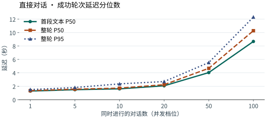
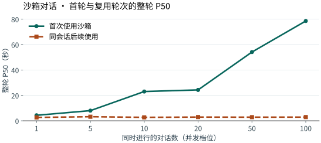
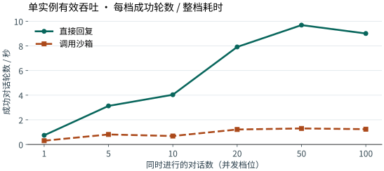

# 性能与指标

Harness APP 的性能主要体现在三个方面：请求能否及时产生响应、单个 Runtime 实例能够持续完成多少轮有效对话，以及负载升高后对话和工具调用是否仍能稳定完成。

对于不使用工具的直接对话，性能主要受模型调用和 SSE 流式传输链路影响；对于使用 Cloud 沙箱的对话，还包含模型发起工具调用、沙箱执行和模型继续回复的完整链路。因此，沙箱场景除整体延迟和成功率外，还需要区分新会话首次使用沙箱与同一会话后续复用沙箱的表现。

## 评估指标

本次测试从响应延迟、有效吞吐和执行稳定性三个维度评估 Harness APP。

| 指标 | 含义 |
| --- | --- |
| 首段文本延迟 P50 | 从客户端发出消息，到收到第一段可见文本的中位耗时，反映用户开始看到回复的速度 |
| 整轮延迟 P50 | 从客户端发出消息，到本轮 SSE 流结束的中位耗时，反映典型请求的端到端完成时间 |
| 整轮延迟 P95 | 95% 的成功请求能够在该时间内完成，用于观察高延迟请求的表现 |
| 有效吞吐 | 单位时间内成功且通过业务校验的对话轮数，单位为轮/秒 |
| 成功率 | 成功且通过业务校验的轮数占全部尝试轮数的比例 |

延迟单位均为秒，只对成功请求计算。P50 是中位数，P95 是第 95 百分位；本文不使用平均延迟或 P99。直接对话的成功条件是收到可见回复且 SSE 流中没有错误；沙箱对话还必须实际调用 `Execute` 执行 `pwd`，并返回正确的工作目录。

## 实际测试

以下数据来自 **1,116 轮真实模型对话**，其中直接对话和 Cloud 沙箱对话各 558 轮。测试使用的 Runtime 资源如下：

| 项目 | 实际配置 |
| --- | --- |
| Runtime 实例数 | 1 个，测试期间固定为 1，不进行扩缩容 |
| 单实例规格 | 2 vCPU、4 GiB 内存 |
| 实例最大并发配置 | 100 |
| 客户端并发 | 1、5、10、20、50、100 |
| 会话与轮次 | 每个并发请求使用独立 Session，每个 Session 连续执行 3 轮 |
| 模型协议 | 方舟模型，Responses 协议 |
| Harness 配置 | 不配置 Skill 和 MCP；沙箱组额外绑定 Cloud Environment |

这里的并发是客户端同时保持的在途对话数，并不表示实例扩容阈值。由于整个测试期间始终只有一个 Runtime 实例，以下结果反映的是同一实例在不同负载下的实际表现，不能用于推断平台会在多少并发时扩容。

### 直接对话

直接对话要求模型只回复简短文本，用于观察不调用工具时的响应延迟。

| 客户端并发 | 首段文本 P50 | 整轮 P50 | 整轮 P95 | 成功率 |
| ---: | ---: | ---: | ---: | ---: |
| 20 | 2.07 秒 | 2.23 秒 | 2.70 秒 | 100%（60/60） |
| 50 | 4.04 秒 | 4.67 秒 | 5.53 秒 | 100%（150/150） |
| 100 | 8.67 秒 | 10.27 秒 | 12.31 秒 | 100%（300/300） |

在 1 至 100 并发范围内，直接对话的 558 轮请求全部成功。并发升高时延迟持续增加：20 并发时整轮延迟 P50 为 2.23 秒，100 并发时增加至 10.27 秒。由于测试使用的是短回复，首段文本与整轮结束时间较为接近；长文本输出的结果可能不同。

### Cloud 沙箱对话

沙箱对话要求模型调用一次 `Execute` 执行 `pwd`。图中分别统计每个新 Session 的首轮请求，以及第二、三轮复用同一沙箱的请求。

| 客户端并发 | 首次使用整轮 P50 | 后续复用整轮 P50 | 全部成功轮次整轮 P95 | 成功率 |
| ---: | ---: | ---: | ---: | ---: |
| 20 | 24.32 秒 | 2.94 秒 | 38.26 秒 | 100%（60/60） |
| 50 | 54.10 秒 | 2.86 秒 | 90.25 秒 | 97.3%（146/150） |
| 100 | 78.55 秒 | 2.92 秒 | 137.07 秒 | 73.3%（220/300） |

沙箱场景中，首次使用和后续复用的差异明显。以 50 并发为例，新 Session 首轮的整轮延迟 P50 为 54.10 秒，而后续两轮复用沙箱时为 2.86 秒。该首轮数据是模型调用、沙箱准备、命令执行和模型回复的端到端耗时，不能将其全部归因于某一个环节。

当并发升至 100 时，300 轮中有 220 轮成功：33 轮发生 SSE 错误，26 轮发生连接错误，21 轮未通过业务校验。此时成功请求的复用延迟 P50 仍为 2.92 秒，但成功率已降至 73.3%，因此不能只用成功请求的 P50 代表整体体验。

### 有效吞吐

有效吞吐按“成功轮数 ÷ 该并发档全部对话的实际持续时间”计算，同时体现处理速度和请求是否正确完成。

| 客户端并发 | 直接对话有效吞吐 | 沙箱对话有效吞吐 |
| ---: | ---: | ---: |
| 20 | 7.91 轮/秒 | 1.21 轮/秒 |
| 50 | 9.69 轮/秒 | 1.30 轮/秒 |
| 100 | 9.01 轮/秒 | 1.24 轮/秒 |

直接对话的有效吞吐在 50 并发时达到本次测试中的最高值 9.69 轮/秒；继续增加到 100 并发后，有效吞吐没有继续上升，而整轮延迟 P50 从 4.67 秒增加到 10.27 秒。沙箱对话在较高并发下的有效吞吐约为 1.2 至 1.3 轮/秒，同时成功率和尾部延迟明显恶化。

## 结果说明

本次实际测试说明，在固定 1 个 2 vCPU、4 GiB Runtime 实例的条件下，直接对话在 100 并发内保持了 100% 成功率，但延迟会随在途请求增多而增长；Cloud 沙箱的后续复用请求较快，而首次使用沙箱是端到端耗时的主要组成部分，在高并发下还会出现更明显的长尾和失败。

测试没有采集 CPU 利用率、请求排队时长、模型服务端追踪或沙箱内部阶段耗时，因此只能描述端到端表现，不能仅凭这些数据确定具体瓶颈，也不能推导自动扩缩容策略。每个并发档只执行一组测试，结果适用于本文所述的短消息、模型和工具组合，不应直接外推到长文本或复杂工具链路。
