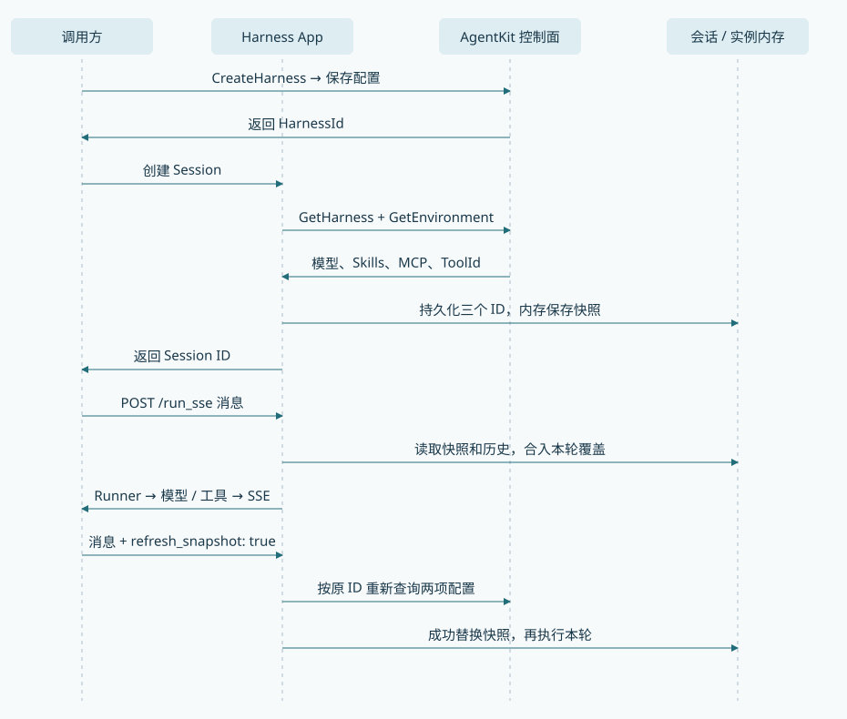

# Harness App 实战教学

本教程带你完成一次可验证的 Harness App 接入：在控制面创建 Harness，在 Runtime 创建绑定会话，通过 `/run_sse` 获得模型回复，再用同一个会话继续追问、读取历史和刷新配置。沙箱、Skill 和 MCP 都是在这条主链路上增加能力，不是另外三套接入方式。

本文适用于 **0.3.1 的 ADK、服务认证部署**。

## 先看完整链路



一次完整调用跨过控制面、Runtime 和实际执行三个边界。调用方保存资源 ID 和会话 ID，Harness App 负责读取配置、维护快照并驱动模型与工具。

| 阶段 | 调用方做什么 | Harness App 做什么 | 成功后能观察到什么 |
| --- | --- | --- | --- |
| 定义配置 | 调用 `CreateHarness` | 控制面保存模型、指令及可选能力 | 返回 `HarnessId` 和 `HarnessVersion` |
| 建立会话 | 将 Workspace、Harness、Environment 三个 ID 传给 Session 接口，可选指定 Harness 历史版本 | 读取 Harness 和 Cloud Environment，将三个 ID 和实际 Harness 版本持久化到 Session state，将配置保存在当前实例快照 | Session 响应回显绑定 ID 和 `harness_version` |
| 执行对话 | 向 `/run_sse` 发送用户消息 | 从快照创建本轮 Agent，由 Runner 调用模型及可选工具 | SSE 依次返回文本、工具活动、最终消息或错误 |
| 延续对话 | 复用 `userId` 和 `sessionId` | 从会话后端读取历史 | 追问可以使用前文，详情接口返回两轮事件 |
| 更新配置 | 更新 Harness，并在下一条消息设置 `refresh_snapshot: true` | 读取最新 Harness 和当前 Environment，先持久化新版本，再替换快照 | 回复体现新配置，后续请求固定使用新版本 |

本页先完成不依赖工具的基础闭环。基础对话成功后，在同一套 Runtime、Harness 和 Session 上选择一个分支继续实践。

| 实践分支 | 相对基础流程增加什么 | 主要验收信号 |
| --- | --- | --- |
| [理解 Harness 配置与版本管理](snapshots.md) | 区分持久化绑定、实例快照和单轮 `harness` 覆盖 | 能说明普通调用、主动刷新和实例恢复分别从哪里取得配置 |
| [在沙箱中执行任务](sandbox.md) | 让模型使用 Environment 提供的 AIO 工具 | SSE 中出现 `functionCall`、成功的 `functionResponse`，文件或命令结果正确 |
| [使用 Skill 完成任务](skills.md) | 在 Harness 中登记 Skill 并刷新快照 | Skill 被加载，最终结果满足技能中可区分的约束 |
| [调用 MCP 工具](mcp.md) | 在 Harness 中登记远程 MCP 服务并刷新快照 | 发现目标工具，调用参数和工具结果可在 SSE 中核对 |

操作分支按“请求、关键响应、验收”组织；配置快照篇集中解释对象关系、生命周期和实例恢复。响应示例只保留判断成功所需的字段；完整契约以 [会话管理接口](../api/app.md)、[对话调用接口](../api/chat.md)和 [Harness 控制面 API](../api/harness.md) 为准。

## 准备调用环境

准备一个已经部署 Harness App 的 Runtime，以及同一 Workspace 中的 Cloud Environment。部署入口见[镜像总览](../intro.md)，Runtime 执行身份所需的完整策略见[权限配置](permissions.md)。

| 准备项 | 在本教程中的用途 |
| --- | --- |
| Runtime 访问地址与调用 Token | 应用创建会话、发送消息、读取历史 |
| Workspace ID、Runtime ID | 在控制面创建 Harness，确定资源归属和运行目标 |
| Cloud Environment ID | 创建会话时解析沙箱 ToolId，后续调用沙箱工具 |
| 模型 ID、地址和 API Key | 保存到 Harness，供服务端执行对话 |
| 可调用控制面 Action 的身份 | 创建、查询和更新 Harness |

控制面的请求使用 AgentKit 签名认证。下面的 Action 示例在已配置认证的 API 调试器或签名客户端中执行。Runtime 示例使用 Bash、curl 和 jq，认证方式按 Bearer Token 展示。

先确认 Environment 的 `Status` 是 `Active`、`Config.Type` 是 `Cloud`，且返回了顶层 `ToolId`。查询时带上 `WorkspaceId`。Harness App 的部署身份也需要拥有 `GetHarness` 和 `GetEnvironment` 的读取权限。应用能创建 Harness，并不自动代表 Runtime 的执行身份可以读取它。[Environment 接口](../api/environment.md)

## 创建 Harness，保存可复用配置

Harness 保存模型、指令和可选的工具能力。多个用户会话可以引用同一个 Harness。

使用签名客户端调用 `POST /?Action=CreateHarness&Version=2025-10-30`，请求体如下。替换所有尖括号中的值，模型地址应支持 Responses API。

```json
{
  "Name": "教学助手",
  "WorkspaceId": "<WORKSPACE_ID>",
  "RuntimeId": "<RUNTIME_ID>",
  "EnvironmentId": "<ENVIRONMENT_ID>",
  "AgentLoop": "adk",
  "Model": {
    "Id": "<MODEL_ID>",
    "Provider": "openai",
    "BaseUrl": "https://ark.cn-beijing.volces.com/api/v3",
    "ApiKey": "<MODEL_API_KEY>"
  },
  "System": "请用中文回答。每次回答第一行写【初始配置】，随后回答用户的问题。"
}
```

关键响应如下。实际响应还包含 `ResponseMetadata` 和 Harness 的其他配置字段。

```json
{
  "ResponseMetadata": {"RequestId": "req_example"},
  "Result": {
    "HarnessId": "agent_example",
    "HarnessVersion": 1,
    "Status": "Active"
  }
}
```

**验收：** `Result.HarnessId` 非空、`HarnessVersion` 为 `1`、`Status` 为 `Active`。保存前两个值；后面的配置更新实验会用到版本号和提示词中的标记。模型输出本身可能有变化。

本教程的 `openai` 默认使用 Responses。需要 Chat Completions 时填写 `openai-completions`。完整字段及嵌套对象见 [CreateHarness](../api/harness.md#createharness-top)。

## 创建用户会话

后续请求发送到 Runtime 地址。在终端设置刚才取得的值。`USER_ID` 用来标识业务用户，`SESSION_ID` 用来标识这位用户的一次对话。

```bash
export RUNTIME_URL='https://<RUNTIME_ENDPOINT>'
export RUNTIME_TOKEN='<RUNTIME_TOKEN>'
export WORKSPACE_ID='<WORKSPACE_ID>'
export HARNESS_ID='<HARNESS_ID>'
export ENVIRONMENT_ID='<ENVIRONMENT_ID>'
export USER_ID='tutorial-user'
```

调用集合创建入口，让服务分配会话 ID。

```bash
jq -n \
  --arg workspace "$WORKSPACE_ID" \
  --arg harness "$HARNESS_ID" \
  --arg environment "$ENVIRONMENT_ID" \
  '{workspace_id:$workspace,harness_id:$harness,environment_id:$environment}' \
  > create-session.json

curl --fail-with-body -sS \
  -D session-headers.txt \
  -H "Authorization: Bearer $RUNTIME_TOKEN" \
  -H 'Content-Type: application/json' \
  --data-binary @create-session.json \
  "$RUNTIME_URL/apps/harness_agent/users/$USER_ID/sessions" \
  > session.json

jq '{id,appName,userId,state}' session.json
export SESSION_ID=$(jq -er '.id' session.json)
```

创建成功返回 Session 对象。下面省略时间戳，并用占位符代替实际 ID。

```json
{
  "id": "<SESSION_ID>",
  "appName": "harness_agent",
  "userId": "tutorial-user",
  "state": {
    "workspace_id": "<WORKSPACE_ID>",
    "harness_id": "<HARNESS_ID>",
    "harness_version": 1,
    "environment_id": "<ENVIRONMENT_ID>"
  },
  "events": []
}
```

**验收：** `id` 非空，`appName` 和 `userId` 与请求一致，`state` 中的三个绑定 ID 与请求完全一致，`harness_version` 是正整数。请求虽然没有指定版本，服务仍会把创建时实际读取到的版本写入 Session。完整返回结构见[创建会话](../api/app.md#post-createsession)。

如果 `session-headers.txt` 含 `X-Session-Id`，保存这个路由头，并在后续请求中原样回传。下面的数组会在有值时自动附带它。

```bash
AFFINITY=$(awk 'tolower($1)=="x-session-id:" {sub(/^[^:]*:[ \t]*/, ""); sub(/\r$/, ""); print}' session-headers.txt | tail -n 1)
ROUTE_HEADERS=()
if [ -n "$AFFINITY" ]; then
  ROUTE_HEADERS=(-H "X-Session-Id: $AFFINITY")
fi
```

创建过程中，Harness App 读取 Harness 和 Environment。三个绑定 ID 和实际 `harness_version` 随 ADK Session 保存，模型、提示词、MCP、Skill 和沙箱配置组成当前实例的内存快照。后续普通消息固定使用这个版本；实例快照丢失时，服务按持久化版本自动重建。

应用已有稳定的业务会话 ID 时，也可以使用带路径 ID 的创建入口。该入口直接接收初始状态对象，具体示例见[按指定 ID 创建会话](../api/app.md#post-createsessionwithid)。

## 发送第一条消息

第一次对话先验证模型和会话链路。下面输入两个数值，下一轮会直接引用它们。

### 请求

```bash
jq -n --arg user "$USER_ID" --arg session "$SESSION_ID" \
  '{appName:"harness_agent",userId:$user,sessionId:$session,streaming:true,
    newMessage:{role:"user",parts:[{text:"请记住，本周处理了120笔订单，上周100笔。计算本周增长率。"}]}}'   > message.json

curl --fail-with-body -sS -N \
  -H "Authorization: Bearer $RUNTIME_TOKEN" \
  "${ROUTE_HEADERS[@]}" \
  -H 'Content-Type: application/json' \
  -H 'Accept: text/event-stream' \
  --data-binary @message.json "$RUNTIME_URL/run_sse" | tee first-turn.sse
```

### 关键响应

终端会逐步收到 `data:` 开头的事件。实际测试中，`partial: true` 的事件携带增量文本，`partial: false` 的事件携带本次模型步骤的完整消息。下面只保留用于理解响应的字段。

`curl -N` 关闭输出缓冲。HTTP 200 表示开始了响应，执行是否成功还要检查流中的错误帧。以下两帧仅演示文本事件的结构。

```text
data: {"partial":true,"author":"harness_agent","content":{"role":"model","parts":[{"text":"【初始配置】本周增长"}]}}

data: {"partial":false,"finishReason":"STOP","author":"harness_agent","content":{"role":"model","parts":[{"text":"【初始配置】本周增长率为 20%。"}]}}

```

**验收：** HTTP 状态为 200，流中没有 `error` 事件；最终完整消息包含【初始配置】，并使用 120 和 100 算出 20%。只看到 HTTP 200 或文本增量都不足以证明本轮完整执行成功。

客户端应按 SSE 消息边界解析帧。增量文本用于临时显示，完整消息用于确认最终内容，避免把两者重复拼接。工具调用、工具结果和错误也会出现在事件中。接入前端时参考[流式事件](features.md)。

## 在同一个会话里追问

保留用户和会话 ID，只改消息。不要为每一轮重新创建 Session。

```bash
jq '.newMessage.parts = [{text:"如果下周再增加相同的订单数，下周是多少笔？"}]' \
  message.json > follow-up.json

curl --fail-with-body -sS -N \
  -H "Authorization: Bearer $RUNTIME_TOKEN" "${ROUTE_HEADERS[@]}" \
  -H 'Content-Type: application/json' -H 'Accept: text/event-stream' \
  --data-binary @follow-up.json "$RUNTIME_URL/run_sse"
```

关键的最终事件应具有以下形态。

```text
data: {"partial":false,"finishReason":"STOP","content":{"role":"model","parts":[{"text":"【初始配置】下周为 140 笔。"}]}}
```

**验收：** 第二轮请求没有重复提供 120 和 100，但最终消息仍计算出下周 140 笔。这说明服务端从会话历史取得了前文。应用需要保存 `userId` 和 `sessionId`，页面刷新后才能继续这次对话。

读取会话详情，确认两轮输入和返回内容已经进入历史。

```bash
curl --fail-with-body -sS \
  -H "Authorization: Bearer $RUNTIME_TOKEN" "${ROUTE_HEADERS[@]}" \
  "$RUNTIME_URL/apps/harness_agent/users/$USER_ID/sessions/$SESSION_ID" \
  | jq '{id,status,title,events}'
```

关键响应应包含同一 `id`、正常结束后的 `status: "idle"`，以及两轮用户消息和模型完整消息。模型响应存在随机性，历史事件才是确认输入是否保存的依据。应用恢复聊天界面、处理断流时，应以会话详情为准。[会话与历史](sessions.md)

```json
{
  "id": "<SESSION_ID>",
  "status": "idle",
  "title": "请记住，本周处理了120笔订单…",
  "events": [
    {"author": "user", "content": {"parts": [{"text": "请记住，本周处理了120笔订单…"}]}},
    {"author": "harness_agent", "partial": false, "content": {"parts": [{"text": "【初始配置】本周增长率为 20%。"}]}},
    {"author": "user", "content": {"parts": [{"text": "如果下周再增加相同的订单数…"}]}},
    {"author": "harness_agent", "partial": false, "content": {"parts": [{"text": "【初始配置】下周为 140 笔。"}]}}
  ]
}
```

## 更新 Harness，观察配置何时生效

回到签名客户端，调用 `POST /?Action=UpdateHarness&Version=2025-10-30`。填入创建返回的 ID 和当前修订号。如果 Harness 已被其他请求更新，先查询最新修订再提交。

```json
{
  "WorkspaceId": "<WORKSPACE_ID>",
  "HarnessId": "<HARNESS_ID>",
  "HarnessVersion": 1,
  "System": "请用中文回答。每次回答第一行写【更新配置】，随后回答用户的问题。"
}
```

更新成功后，`Result.HarnessVersion` 应从 `1` 变为 `2`，并回显新的 `System`。保存新版本号。更新只产生新的控制面修订，不会修改已有 Session 固定的 `harness_version`；只有调用方显式刷新，Session 才会采用最新版本。[UpdateHarness](../api/harness.md#updateharness-top)

```json
{
  "Result": {
    "HarnessId": "agent_example",
    "HarnessVersion": 2,
    "System": "请用中文回答。每次回答第一行写【更新配置】，随后回答用户的问题。"
  }
}
```

先用普通请求询问订单总数，观察旧快照的行为。

```bash
jq '.newMessage.parts = [{text:"本周处理了多少笔订单？"}]' message.json > check-config.json
curl --fail-with-body -sS -N \
  -H "Authorization: Bearer $RUNTIME_TOKEN" "${ROUTE_HEADERS[@]}" \
  -H 'Content-Type: application/json' \
  --data-binary @check-config.json "$RUNTIME_URL/run_sse"
```

**验收固定版本：** 最终完整消息仍以【初始配置】开头。控制面更新成功，不等于已有 Session 已经切换版本。

然后在相同消息里加入刷新字段。

```bash
jq '.refresh_snapshot = true' check-config.json > refresh.json
curl --fail-with-body -sS -N \
  -H "Authorization: Bearer $RUNTIME_TOKEN" "${ROUTE_HEADERS[@]}" \
  -H 'Content-Type: application/json' \
  --data-binary @refresh.json "$RUNTIME_URL/run_sse"
```

刷新成功后的关键最终事件应体现新的指令，同时仍能回答历史中的订单数据。

```text
data: {"partial":false,"finishReason":"STOP","content":{"role":"model","parts":[{"text":"【更新配置】本周处理了 120 笔订单。"}]}}
```

**验收新版本：** 最终完整消息以【更新配置】开头，并正确回答本周为 120 笔。前者证明新配置已影响模型，后者证明刷新没有创建新对话或丢失历史。再次查询 Session 时，`state.harness_version` 应为 `2`；此后省略刷新字段也会固定使用 v2。输出标记适合观察行为，精确诊断时需结合 Session state 和服务日志。

| 请求时机 | 使用的配置 |
| --- | --- |
| 刚创建 Session | 创建时选定的 Harness 版本和 Environment |
| 控制面更新后，普通消息 | Session 固定版本对应的快照 |
| 显式刷新成功 | 最新 Harness 版本和当前 Environment；新版本写回 Session |
| 显式刷新失败 | 本轮在建流前失败，原版本和原快照继续保留 |
| 实例重启后，内存快照缺失 | 服务按 Session 中的固定版本自动重建，再执行普通消息 |

实例重启后的恢复还要求 Session 使用持久化后端。默认的本地内存会话会随进程退出丢失，数据库配置见[高级配置](advanced.md#会话存储与-postgresql)。

## 应用接入时需要保存什么

应用保存用户标识、创建响应中的会话 ID，以及网关返回的可选路由头。发消息时提供本轮输入。切换业务对话时使用另一份 Session ID。

| 接入行为 | 处理方式 |
| --- | --- |
| 页面重新打开 | 查询会话详情并恢复历史 |
| 实例重启或请求切换副本 | 继续发送普通消息；服务按 Session 固定版本自动恢复快照 |
| 收到执行错误帧 | 展示错误并结束本次流的处理 |
| 网络中断，结果未知 | 先读取历史，确认已保存的结果，再决定是否提交新一轮 |
| 需要临时覆盖模型或指令 | 使用请求级 harness，规则见高级配置 |
| 需要清理会话 | 调用 DeleteSession，先确认应用已完成历史留存 |

普通运行请求没有自动去重保证，网络中断后直接重发可能产生额外一轮执行。Session 资源见[会话管理接口](../api/app.md)，运行响应和错误契约见[对话调用接口](../api/chat.md)。

基础闭环完成后，不需要重新接入 Harness App。继续沿用本教程的变量和会话，进入[沙箱](sandbox.md)、[Skill](skills.md)或[MCP](mcp.md)分支，只修改能力配置和验证任务。应用仍只调用 Runtime HTTP 入口；Harness App 处理会话和快照，创建本轮 Agent，再交给进程内的 VeADK Runner 执行模型和工具。修改服务端实现时，从[开发入口](develop.md)定位对应代码。
