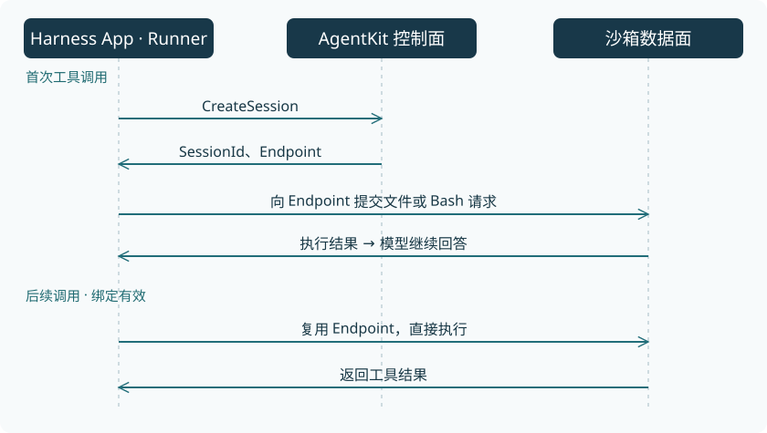

# 在沙箱中执行任务

本篇是[实战教学](flow.md)的沙箱分支。继续使用主教程中的 Runtime、Harness、Environment 和 Session，通过两轮对话完成“写入文件—读回并计算”的闭环。应用仍然只调用 `/run_sse`；模型选择工具后，Harness App 才取得当前对话对应的沙箱地址，在远端执行操作并把结果交回模型。

| 相对基础流程 | 本篇做什么 |
| --- | --- |
| 配置 | 不需要再创建 Harness 或 Session；主教程绑定的 Cloud Environment 提供沙箱 ToolId |
| 第一轮 | 创建 `orders.csv` 并读回，确认文件真实存在 |
| 第二轮 | 复用同一会话和沙箱，执行命令计算合计 |
| 验收 | 同时检查 `functionCall`、`functionResponse` 和最终文本，不能只看模型声称“已完成” |

为 ADK 后端的 Harness Agent 配置 AIO 沙箱 Tool 后，模型可以选用 `Execute`、`ReadFile`、`EditFile` 和 `WriteFile`。普通问答可以在模型已经看到这些工具的情况下直接完成，不会因此自动创建物理沙箱。

## 先完成一次写入和读回

沿用[实战教学](flow.md)中的 Runtime、会话和终端变量。这个练习会在绑定的 Cloud 沙箱里创建 `orders.csv`，再从下一轮读取它。请求成功与工具执行成功分别检查，文件内容以工具返回为准。

```bash
jq '.harness.tools = "bash,read,write" | .newMessage.parts = [{text:"请调用沙箱工具，在工作目录创建 orders.csv，内容为 city,amount 换行 北京,120 换行 上海,80。写完后读回，核对文件内容。"}]' \
  message.json > sandbox-write.json
curl --fail-with-body -sS -N \
  -H "Authorization: Bearer $RUNTIME_TOKEN" "${ROUTE_HEADERS[@]}" \
  -H 'Content-Type: application/json' \
  --data-binary @sandbox-write.json "$RUNTIME_URL/run_sse"
```

下面是模型选择 `WriteFile` 时经过裁剪的关键事件。实际调用 ID、工具组合和文本分片会变化；模型也可能使用 `Execute` 完成同一任务。

```text
data: {"partial":false,"content":{"role":"model","parts":[{"functionCall":{"id":"call_1","name":"WriteFile","args":{"path":"/workspace/orders.csv","content":"city,amount\n北京,120\n上海,80\n"}}}]}}

data: {"content":{"role":"user","parts":[{"functionResponse":{"id":"call_1","name":"WriteFile","response":{"status":"ok","message":"Wrote /workspace/orders.csv"}}}]}}

data: {"partial":false,"finishReason":"STOP","content":{"role":"model","parts":[{"text":"已创建并读回 orders.csv，包含北京 120、上海 80。"}]}}
```

**验收：** 工具调用中的路径和内容正确，对应的 `functionResponse.response.status` 为 `ok`，读回结果包含表头和两条记录，最后才检查模型说明。仅在回答中出现“文件已创建”还不足以确认文件存在。

下一轮沿用相同会话，让模型从文件计算合计。

```bash
jq '.harness.tools = "bash,read,write" | .newMessage.parts = [{text:"读取刚才的 orders.csv，用沙箱执行命令计算 amount 的合计，并返回命令结果。"}]' \
  message.json > sandbox-read.json
curl --fail-with-body -sS -N \
  -H "Authorization: Bearer $RUNTIME_TOKEN" "${ROUTE_HEADERS[@]}" \
  -H 'Content-Type: application/json' \
  --data-binary @sandbox-read.json "$RUNTIME_URL/run_sse"
```

若模型选择 `Execute`，关键响应具有以下形态。

```text
data: {"partial":false,"content":{"role":"model","parts":[{"functionCall":{"id":"call_2","name":"Execute","args":{"command":"awk -F, 'NR>1 {sum+=$2} END {print sum}' orders.csv"}}}]}}

data: {"content":{"role":"user","parts":[{"functionResponse":{"id":"call_2","name":"Execute","response":{"status":"ok","stdout":"200\n"}}}]}}

data: {"partial":false,"finishReason":"STOP","content":{"role":"model","parts":[{"text":"amount 合计为 200。"}]}}
```

**验收：** 工具结果的 `status` 为 `ok`、标准输出包含 `200`，最终回复与工具结果一致。第二轮没有重新上传文件，因此成功读到数据也验证了同一会话下的沙箱复用。工具选择由模型决定，本文的文件内容和计算结果才是稳定的验收目标。

## 会话输入文件 {#session-input-files}

已有 Ark File ID 时，可在[创建会话](../api/app.md#post-createsession)的顶层传入 `fileIds`。两个创建入口均支持，最多 100 项并按原顺序去重；非空列表要求会话绑定 ADK AIO 沙箱。ID 声明保存为 `state.fileIds`，不能通过后续状态更新替换。

```json
{"workspaceId":"ws-example","agentId":"agent_example","environmentId":"env_example","fileIds":["file-report","file-data"]}
```

创建成功表示文件声明已保存。之后通过 `/run_sse` 让模型读取 `/workspace/uploads/file-report/report.pdf`（假设原文件名为 report.pdf）；首次调用沙箱工具时，Runtime 使用本轮模型 API Key 查询 Ark Files，要求文件为 `active`、`purpose=agent` 且有 HTTPS 下载地址，再向沙箱提交异步下载任务。API Key 留在 Runtime，沙箱接收文件 ID、下载地址和大小。

沙箱镜像须提供配套的 `/usr/local/bin/ve-load-files`。任务被接受后，Runtime 立即继续工具执行，不轮询下载进度；下载完成的文件以原子方式落到 `/workspace/uploads/<fileId>/<filename>`。因此，首次读取可能因文件尚未就绪而失败，应稍后再读；后台下载失败后没有自动重试。已接受的启动在当前物理沙箱和文件列表下复用，替换沙箱后会重新准备。

默认工作目录为 `/workspace`。部署可以通过 `VEADK_AIO_WORKSPACE` 调整普通工具的工作目录，但当前配套文件加载器要求使用 `/workspace/uploads`。文件加载器每文件上限 512 MiB、每批上限 1 GiB、下载时限 600 秒；这些限制依赖配套沙箱镜像。

需要直接发送本地文件时，使用[文件操作接口](../api/files.md#post-uploadsessionfile)上传至会话沙箱；该接口单文件上限 8 MiB，成功响应表示写入完成。

## 读取沙箱图片并交给视觉模型

在 **0.4.0** 中，ADK 的 `ReadFile` 可读取沙箱中的 PNG、JPEG、WebP 和 GIF 图片。把图片放在工作目录后，让模型调用 `ReadFile` 并提供文件路径；工具依据扩展名判断图片类型，再核对实际文件签名。只有类型一致且内容不超过 **5 MiB** 时，工具才返回 `status: ok` 和 `content` 中的 base64 图片块。图片不支持 `start_line`、`end_line` 行范围；类型不符、超限、文件不存在等情况在工具结果中返回 `status: error`。

```json
{"path":"/workspace/chart.png"}
```

成功的 `functionResponse.response` 形态如下，`data` 是实际图片字节的 base64；这里用占位文本表示，不应按字面发送：

```json
{"status":"ok","content":[{"type":"image","source":{"type":"base64","media_type":"image/png","data":"<base64-image-bytes>"}}]}
```

Harness Chat 和 OBO 的 Chat Completions 模型调用会把工具图片转换为后续视觉输入。转换只影响送给模型的请求副本；会话事件仍保留原始工具响应。调用方消费 SSE 或读取历史时应按工具响应结构处理图片，避免把大段 base64 直接渲染为文本。是否生成图片解读还取决于所选模型的视觉能力。

## 绑定会话如何取得沙箱 Tool

在 [创建到对话的流程](flow.md) 中，`environmentId` 指向与 Harness 同一 Workspace 的 Active Cloud Environment。App 以服务身份调用 `GetEnvironment`，将返回的 `ToolId` 写入实例快照的 `sandbox.tool_id`。SelfHosted Environment 和缺少 ToolId 的配置在解析阶段返回 422。后续普通消息使用快照；若只想调整本轮 TTL，可以传 `"harness":{"sandbox":{"ttl":3600}}`，保留快照的 ToolId。

读取 Environment 时尚未分配物理沙箱。ADK 根据最终的 ToolId 装配 AIO 工具；`agent_toolset_20260401` 开关解析见 [内置工具、MCP 与 Skills](tools.md)。下文说明模型选用工具后的执行过程。

## 从一次对话看文件在哪里

假设一个报告助手需要处理订单。应用始终向 Harness App 的 `POST /run_sse` 发送消息，保存同一组应用、用户和对话标识。

| 用户消息 | 模型选择 | 实际执行 |
|---|---|---|
| “解释一下 CSV 格式。” | 直接回答 | 这一轮只用模型推理，不触发沙箱创建。 |
| “把以下三笔订单写入工作目录的 orders.csv。” | 调用 WriteFile | 首次使用沙箱工具时，Harness App 根据选定的 Tool 获取沙箱 Session 和 Endpoint，再把文件写入沙箱工作目录。 |
| “读回刚才的文件，按城市汇总。” | 调用 ReadFile 或 Execute | 同一实例上绑定仍有效时直接复用 Endpoint，读取上一轮生成的文件。Runner 把读取内容或命令结果交给模型，再通过原来的对话连接返回回答。 |

这里有三个不同的标识：应用持有**对话 sessionId**；Harness App 从应用、用户和对话标识派生稳定的 **UserSessionId**，用于关联创建请求；AgentKit 控制面返回的 **SessionId** 指向某一次实际分配的沙箱。用户能读回同一个文件，取决于后两轮是否落在同一个物理沙箱。

## 从工具声明到执行结果



1. **向模型提供工具。** Harness App 按部署配置及入口允许的请求参数准备 Harness Agent。启用 AIO 后，工具集仅声明选中的沙箱工具。除四种原生工具外，还可启用 grep（正则搜索文本）和 glob（按模式列出路径）。若配置 Skill，准备模型请求时还可读取技能目录信息。
2. **从对话定位 Endpoint。** 模型发起沙箱工具调用后，执行器从工具上下文读取应用、用户和会话，在进程内串行处理同一绑定。首次使用时先按稳定的 `UserSessionId` 查询仍有效的沙箱；没有匹配项才向 AgentKit 控制面发送 `CreateSession`，参数包括 `ToolId`、`UserSessionId` 和 `Ttl`。取得可用 Endpoint 后缓存。
3. **把操作发到沙箱数据面。** 读取文本走 `/v1/file/read`，写入走 `/v1/file/write`。执行命令时，适配器先在工作目录创建 Bash 会话，再向 `/v1/bash/exec` 提交命令；需要等待时读取命令输出，最后取得标准输出、标准错误和退出码。文件路径相对于沙箱工作目录解析。调用方机器上的同名文件不会自动出现在该目录。
4. **继续模型执行。** 原生 ADK 工具将结果交回 Runner。模型可继续选工具，也可生成回答。前端沿原来的 Harness App 连接消费[流式事件](features.md)，无需自行构造沙箱 HTTP 请求。

### 何时会重新取沙箱

| 情形 | Harness App 的行为 |
|---|---|
| 当前绑定可用 | 直接向缓存的 Endpoint 发请求。 |
| 创建请求结果不确定 | 保留逻辑标识，后续可用 ListSessions 回查，避免因超时而重复创建。 |
| Endpoint 疑似失效 | 通过 GetSession 核实已有沙箱。文件读取返回 404 本身不足以证明整个沙箱已消失。 |
| 已知 TTL 到期 | 再次使用工具时创建新沙箱。同一对话可以继续，但此前沙箱内的临时文件可能已经不可用。 |
| Runtime 重启或请求切换到其他副本 | 进程内绑定丢失后，会按稳定的 UserSessionId 查询仍有效的物理沙箱并重新附着。会话历史仍依赖持久化后端；沙箱已过期或被删除时旧文件不可恢复。 |

### 读懂权限错误

创建沙箱时检查 Runtime 对 Session AgentKit 控制面的授权；调用文件或 Bash 时检查 Endpoint 和沙箱数据面的认证；能看到技能说明但取不到文件时，还需检查加载器访问 Skill 服务及下载制品的身份。Skill 下载链路使用临时下载 URL，目标沙箱镜像应提供与下载协议相匹配的加载器。完整 IAM 策略和分阶段的 Action 见[权限配置](permissions.md)。
